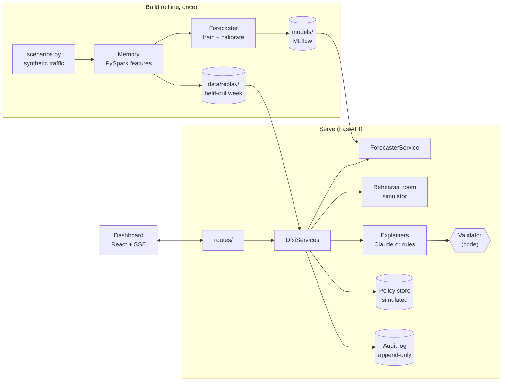
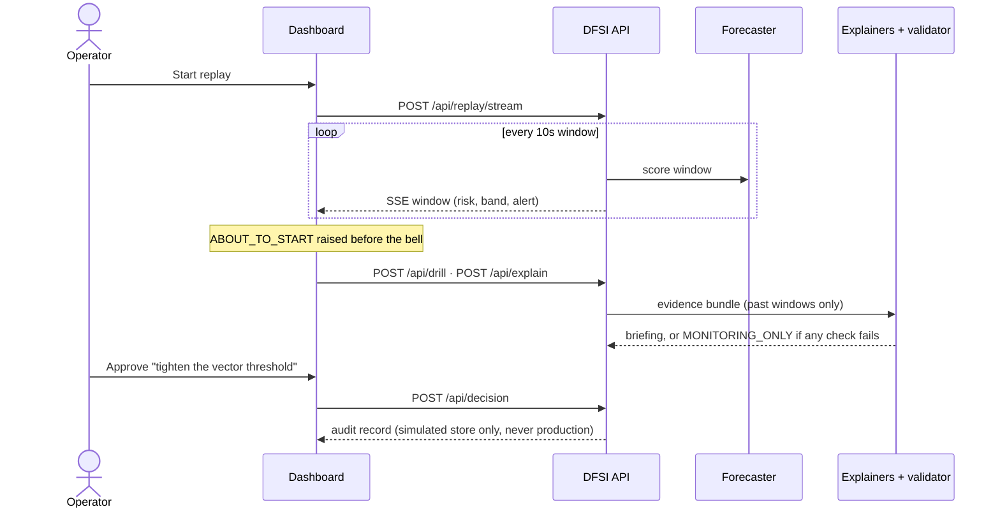

# DFSI — DDoS Future-State Intelligence

[](https://github.com/kishorecec/hackthon2026/actions/workflows/ci.yml)

> See the storm before it lands.
>
> **ML makes the numbers. AI explains them. Humans decide.**

A predictive lookout layer that sits *beside* `netsec-ddos-shared-state-2`. Shared
State ("the bell") today waits for blocking to persist for the full start
duration before it declares an attack. DFSI forecasts a new lifecycle state —
**`ABOUT_TO_START`** — so an operator gets a head start on the same event.

DFSI is **read-only and simulation-only.** It never changes a customer's
configuration, never blocks traffic and never executes a policy.

---

## The four components

| | What it is | Where |
|---|---|---|
| **Memory** | PySpark over months of historical traffic → features ("clues"). *Like a ship's logbook.* | `dfsi/memory/` |
| **Forecaster** | Gradient-boosted trees + MLflow; a risk score for the next 120s, every run and model version tracked. *Like a lookout with a spyglass.* | `dfsi/forecaster/` |
| **Rehearsal room** | Policy simulator: tries four candidate responses on a replay and shows the trade-offs. Nothing touches production. *Like a practice drill.* | `dfsi/rehearsal/` |
| **Explainers** | Two bounded AI agents plus a code-based validator that checks every claim. *Like the first mate briefing the captain.* | `dfsi/agents/` |

### How they fit together



One operator decision, end to end:



---

## Prerequisites

| | Version | Why |
|---|---|---|
| Python | **3.12** | What the project is pinned and measured against |
| JDK | **11, 17 or 21** | PySpark 3.5 breaks on JDK 23+ — `javax.security.auth.Subject.getSubject` was removed and Hadoop still calls it |
| Node | 20+ | Vite 5 / React 18 dashboard |

Only the Memory stage needs the JDK. Training, the API and the UI do not.

```bash
brew install openjdk@17          # if you have none
python3.12 -m venv .venv
.venv/bin/pip install -r requirements.txt
(cd ui && npm install)
```

`scripts/env.sh` resolves a usable JDK automatically and fails loudly if it
cannot find one, so you do not need to export `JAVA_HOME` yourself.

---

## Running it — command line

One command, from a bare checkout to a dashboard. It creates the venv, installs
both dependency sets, builds Memory, trains the Forecaster, starts the API,
waits for it to answer, then opens the UI. Every stage is skipped when its
output already exists, so a second run serves in seconds, and one Ctrl-C stops
both servers.

Generated output is not committed: `.venv/`, `data/`, `models/`, `mlruns/`,
`logs/`, `ui/node_modules/` and `ui/dist/` are in `.gitignore`. On a fresh
checkout the first `scripts/run.sh` builds them (the Memory layer takes about
20 minutes for four weeks over all 42 ranges on a 12-core laptop; with `--days 14`
the build and training together take about 5).

```bash
scripts/run.sh
```

```bash
scripts/run.sh --rebuild        # force Memory + training again
scripts/run.sh --test           # run the test suite before serving
scripts/run.sh --no-ui          # API only
scripts/run.sh --build-only     # build, don't serve
scripts/run.sh --days 28        # weeks of history (default 28: warm-up, fit, calibration, test)
```

`DFSI_PORT` and `DFSI_UI_PORT` move the two servers off 8000/5173; the UI's
`/api` proxy follows automatically.

### The stages on their own

Four stages, in order. The first two are build steps; the last two are the demo.

```bash
scripts/build_memory.sh          # Memory: PySpark → features + replays (~20 min, 28 days)
scripts/train.sh                 # Forecaster: train, calibrate, register in MLflow
scripts/serve_api.sh             # API on http://127.0.0.1:8000  (docs at /docs)
cd ui && npm run dev             # Dashboard on http://127.0.0.1:5173
```

`scripts/demo.sh` is the older version of the same path; it assumes the venv and
dependencies are already in place, where `scripts/run.sh` builds them.

Useful variations:

```bash
scripts/build_memory.sh --days 14                # smaller: then train with `scripts/train.sh --split scenario`
scripts/build_memory.sh --env prod               # 300s start duration instead of 30s
scripts/train.sh --false-alarm-budget 0.05       # trade false alarms for lead time
.venv/bin/python -m pytest -q                    # unit tests (see Development)
.venv/bin/python -m mlflow ui --backend-store-uri mlruns   # browse tracked runs
```

### Approving a policy change, then replaying the attack

`raw.json` is the policy database: per account, range and traffic type, the
configured line (`max_threshold_pps` / `max_threshold_mbps`). The API loads it
into an in-memory, versioned policy store, and every replay is re-derived under
the store's current lines. That covers what the wall blocks, the policy-based
features the forecaster reads, and when Shared State's bell rings.

1. Replay an attack, run the drill, and pick **Tighten the vector threshold**.
   The suggestion comes from the past week of that range's traffic.
2. **Approve** it. The suggested lines are written to the store (a new version,
   with history), and the audit record says `applied: true`. Picking an option
   other than the Advisor's records `verdict: "changed"` with the overridden
   `recommended_policy_key`; the record states the server's model version, and
   flags `client_model_version` if the dashboard was showing a different one.
3. **Replay the same attack.** It now runs under the new lines. The *Policy
   store* panel compares the two runs: when DFSI warned, when the bell rang, how
   much was dropped at the wall, and the peak still reaching the range.

Only threshold changes are applied, and only to this simulated store. Nothing
reaches Behemoth, Shared State or a customer's configuration. Restarting the
API, or **Reset to raw.json** (`POST /api/policies/reset`), restores the seed.
`GET /api/policies` shows the store and its history. `DFSI_POLICY_DB` points
the store at a different file.

Each range can also set its own `risk_threshold`: the risk score at or above
which a window counts towards a DFSI warning on that range. A range without one
uses the model's calibrated threshold. It moves the dashed line on the timeline,
the risk bands, the warning, and so the head start. It is read when the API
starts, so edit `raw.json` and restart to change it. `GET /api/risk-thresholds`
shows what is in effect.

### The agents

Set `ANTHROPIC_API_KEY` before starting the API to run the two explainers on
Claude (`claude-opus-5-5`, override with `DFSI_CLAUDE_MODEL`). Without it they fall back to an offline rule engine
and `/api/health` reports `agent_engine: "offline-rules"` — a supported mode,
and what the test suite exercises.

```bash
export ANTHROPIC_API_KEY=sk-ant-...
scripts/serve_api.sh
```

Either way the **validator runs in code, not in a prompt.** It checks tenant
scope, output format, evidence freshness, that every number in the prose is in
the evidence bundle, that every structured citation names a real feature *at
its real value*, and the allowed action list. Structural durations (the 120s
horizon, the 10s window, the start durations) are tolerated only when written
as durations, so "300 Mbps" or "60%" must still be found in the evidence.

How strict "found in the evidence" is:

- **Claude may quote only what its tools returned.** A number in the bundle
  that the agent never asked for (the drill, say, when it read only the
  traffic) does not count. The offline rules are checked against the whole
  bundle; they read it directly and cannot invent anything.
- **Rounding must stay faithful.** In prose, 0.4231 may be quoted as 0.42 or
  42%, but a rendering more than 5% off (0.4, or 7 for 7.4) is a different
  number. A structured citation (`{feature, value}`) is held tighter, to 1% of
  the feature's real value.
- **Digits only.** Scientific notation ("1e6") and figures spelled out in words
  ("twelve times", "three thousand") cannot be traced, so they are refused;
  small counts ("two agents", "four options") are fine. Epoch timestamps are
  not citable figures.
- **Freshness has two halves.** Evidence newer than the decision instant is
  evidence from the future (in a replay, even one window; against a live
  clock, one window of skew is allowed); a forecast more than 90s older than
  "now" is stale, however fresh the traffic rows beside it.

Every check runs inside the fail-safe: an output that breaks the validator
itself is withheld as `MONITORING_ONLY`, never served. Agents are forbidden from producing risk figures — ML owns
those. On any validation failure DFSI falls back to **`MONITORING_ONLY`**, never
to "low risk".

---

## Running it — IntelliJ IDEA

The project ships `.idea/` with six run configurations. Open
the repository root as the project.

**One-time setup:** point the interpreter at the venv.
*Settings → Project: dfsi → Python Interpreter → Add Interpreter → Existing
environment →* `<project>/.venv/bin/python`, and name it **`Python 3.12 (dfsi)`**
(the run configurations reference that name). IntelliJ usually detects `.venv`
on first open and offers it.

Then pick from the run dropdown:

| Configuration | What it does |
|---|---|
| **1 · Memory (PySpark)** | Builds the feature table. Pins `JAVA_HOME` to JDK 17 for you. |
| **2 · Forecaster (train)** | Trains, calibrates the threshold, logs to MLflow. |
| **3 · API (uvicorn 8000)** | Serves the trigger, with `--reload`. |
| **4 · UI (vite 5173)** | `npm run dev` in `ui/`. |
| **Demo (API + UI)** | Compound — starts 3 and 4 together. |
| **Tests (all)** | pytest over `tests/`. |

Run **1**, then **2**, then **Demo**. Configurations 1–3 all export
`DFSI_HOME=$PROJECT_DIR$`, so nothing is written outside this directory.

If the IDE flags `from dfsi...` as unresolved, mark the project root as a
source root (right-click → *Mark Directory as → Sources Root*); `.idea/dfsi.iml`
already declares it, but the setting only takes effect once the interpreter is
configured.

---

## The demo flow

1. **Replay synthetic traffic** — pick a scenario and press *Start replay*. One
   SSE event per 10-second window.
2. **The risk score climbs before the threshold alarm** — the timeline draws
   the gap between DFSI's first warning and the moment the bell would ring.
3. **Ask the agents** — *attack or flash crowd?* The investigator gathers
   evidence; the validator strip shows every check it passed.
4. **Compare four responses** in the rehearsal room — `hold`,
   `tighten_vector`, `rate_limit_sources`, `full_scrub` — with suppression,
   collateral, time-to-contain and blast radius for each.
5. **A human approves** one. The decision is appended to an audit log. Only an
   approved threshold change is applied, and only to DFSI's simulated policy
   store — **never to production** (see *Approving a policy change* above).

---

## Measured results

Synthetic scenario set, stage thresholds. Four weeks of traffic: the first is
warm-up for the baselines, the model is fitted on the next, the decision
threshold is set on the one after, and everything below is measured on the
final week, which the model never saw (7,056 scenarios across the 42 ranges in
`raw.json`, 1,047 forecastable attacks).
Decision threshold 0.55, evidence gate 3.0.

**The threshold is the configured fallback, not a calibrated value.** Training
sweeps thresholds on the calibration week and takes the lowest whose false-alarm
rate is within a 3% budget. On this build no threshold met it (the lowest was
4.2%, at 0.95), so training kept the configured 0.55, and the model card says
so (`calibration.source: "fallback"`). For comparison, on the calibration week
(raw score, before the gate) 0.55 gives 10.6% false alarms, a 60s median head
start and every attack caught; 0.95 gives 4.2%, 50s and 99.5%. Neither is within
budget, so the choice between them is a judgement call, and it is left visible
here rather than labelled "calibrated".

| | DFSI | Threshold alarm (today) |
|---|---|---|
| Median head start | **60s** | 0s |
| p10 head start | 10s | 0s |
| Attacks caught early | **100%** (1,047/1,047) | 0% |
| Late warnings | 0 | 1,047 |
| False-alarm rate | 5.1% | 0% |

These are regenerated by `scripts/train.sh` and served live at
`/api/model-card`; if the two ever disagree, the model card is current. One
synthetic week is a small sample: read these as estimates, not guarantees.

"Caught early" means warned before the bell, at any distance. The forecast
horizon is 120s, yet 338 of the 1,047 head starts are longer than that, some
by many minutes: those warnings came from sustained abnormal traffic rather
than a two-minute forecast, so read the catch rate as early *detection* as much
as prediction. The head start varies a lot by scenario type, and is mostly *early
detection* rather than foresight for the fast ones: `gradual_buildup` is warned
about a median 230s ahead, but `sustained_attack` only 40s and `pulse_wave` 10s,
which is about the 30s start duration on this stage configuration.

### The evidence gate

The forecaster leans on context (recent attack history on the account) as well
as traffic, so an ordinary flash crowd on an account attacked last week could
alert with the traffic still inside its normal range. An alert therefore also
needs **traffic evidence**: the strongest per-vector deviation must exceed 3 (the
pipeline's own bar for an abnormal window). The risk score itself is untouched,
and a withheld window still shows it, flagged `gated` with the reason. Missing
data never suppresses an alert.

On the same model and threshold, with the gate off versus on:

| | no gate | gate |
|---|---|---|
| False-alarm rate | 10.7% | **5.1%** |
| Flash-crowd false alarms | 56% | **16%** |
| Attacks caught | 1,047/1,047 | 1,047/1,047 |
| Median / p10 head start | 60s / 10s | 60s / 10s |

On this build the gate costs no head start: `gradual_buildup`'s median is 230s
with or without it. (A slow ramp is still not alerted until its deviation passes
the bar, so on other builds this can cost a window or so.) The effect was
measured on synthetic data only. A second-stage classifier trained to tell
attacks from flash crowds was tried first, on an earlier and smaller scenario
set, and removed only one point of flash-crowd false alarms, because the flash
crowds that alert look attack-like on traffic; see `dfsi/forecaster/gate.py`.

**How lead time is counted** — three rules, because getting any wrong moves the
headline by tens of seconds:

- *The clock starts at the bell, not at the threshold crossing.* Shared State
  crosses the policy-relative threshold, then waits out the start duration
  before declaring. Scoring a detector on the crossing credits it with that
  wait as though it were foresight — a free 20s here, 290s in production. The
  incumbent's warning **is** the declaration, so its lead is zero by
  construction. That is the comparison, not a bug.
- *A warning is credited when it can first be acted on.* It takes two windows in
  a row above the threshold, and the head start is counted from the second, not
  back to the first, because nobody can be told about a window before the next
  one has been seen.
- *Lead time is only defined where there was a runway.* `recovery` episodes open
  already over threshold, so there is no pre-attack history to forecast from.
  Those 218 scenarios are reported separately as `in_progress_detected` (100%
  detected) rather than averaged into the head-start figure.

See `dfsi/forecaster/metrics.py` and `tests/test_metrics.py` — both rules are
asserted, not assumed.

---

## Anti-leakage discipline

A forecaster that can see the future scores beautifully and is worthless.

- The split is by **whole scenario** (`GroupShuffleSplit` on `scenario_id`), so
  neighbouring 10-second windows can never straddle it.
- `scenario_id` and `scenario_type` are **never model inputs**.
- Every feature is built from a window frame ending at the current row. The
  label is the only forward-looking column, and it is dropped before fitting.
- Baselines come from quiet windows only, broadcast-joined, so a test scenario
  never contributes to the baseline it is measured against.
- `assert_no_leakage` fails the run loudly if a forbidden column reaches the
  feature list, and `tests/test_leakage.py` asserts every rule above.

---

## Safety model

- **Read-only.** No write path to any customer configuration exists in this
  codebase.
- **Simulation only.** Every rehearsal result is tagged `simulation_only` and
  carries its stated assumptions.
- **Bounded agents.** Each gets a few read-only tools and a role-scoped tool
  allow-list; reaching outside it fails validation.
- **Fails safe.** Any failure in the prediction or explanation path returns
  `MONITORING_ONLY` — explicitly "unknown", never "low risk" or "all clear".
- **No raw IPs.** Source information is reduced to country-mix concentration
  and a per-account attack count. Nothing in `data/` contains an address.
- **Versioned and auditable.** Every forecast records its feature version and
  model version; every simulated decision is appended to `data/decisions/`.

All traffic in this project is **synthetic** (`dfsi/memory/scenarios.py`).

---

## Known limitations

Served live at `/api/model-card` and shown in the dashboard footer. In short:
synthetic data only; `recovery` scenarios cannot be forecast by construction; a
flash crowd that crosses the policy threshold is a true onset by DFSI's label
definition even with no attacker involved; the rehearsal room's suppression and
collateral figures are stated assumptions rather than measurements of
Behemoth's real behaviour; and an attack evenly spread across many countries
loses the `source_profile` signal.

Related: **PPNG-6760** — Behemoth can block a whole /24 and catch Teams/Zoom
traffic by mistake. That is why `full_scrub` always carries a blast-radius note
in the rehearsal room.

---

## API

Interactive OpenAPI docs are served at `http://127.0.0.1:8000/docs`.

| Method | Path | What it does |
|---|---|---|
| GET | `/api/health` | Service, model and agent status (`ok` / `degraded`) |
| GET | `/api/replays` | The scenario catalogue (503 until Memory is built) |
| GET | `/api/model-card` | Model version, metrics, evidence gate, known limitations |
| POST | `/api/replay/stream` | SSE: `start`, one `window` per 10s, then `summary` |
| POST | `/api/drill` | The four candidate responses, plus opt-in uncertainty and cost of waiting |
| POST | `/api/explain` | Investigator + Advisor, each with its validator checks |
| POST | `/api/decision` | Record a human decision; an approved threshold change updates the simulated store |
| GET | `/api/decisions?limit=50` | The audit log, newest first (1–500) |
| GET | `/api/policies` | The simulated policy store and its history |
| POST | `/api/policies/reset` | Restore the store to `raw.json` |
| GET | `/api/risk-thresholds` | Model default and per-range `risk_threshold` |

Errors are JSON `{"detail": "..."}`: 404 for an unknown replay, 400 for an
epoch that is not a window of the replay, 422 for a malformed or uncomputable
request, and 503 when a generated artefact is missing.

```bash
curl -s localhost:8000/api/health | jq
ID=$(curl -s localhost:8000/api/replays | jq -r '.replays[0].replay_id')
curl -sN -X POST localhost:8000/api/replay/stream \
     -H 'Content-Type: application/json' -d "{\"replay_id\": \"$ID\", \"speed_seconds\": 0}"
curl -s -X POST localhost:8000/api/drill -H 'Content-Type: application/json' \
     -d "{\"replay_id\": \"$ID\", \"include_uncertainty\": true}" | jq '.candidates[] | {policy_key, time_to_contain_seconds}'
curl -s -X POST localhost:8000/api/explain -H 'Content-Type: application/json' \
     -d "{\"replay_id\": \"$ID\"}" | jq '{state, reading: .investigator.output.reading}'
```

---

## Development

```bash
.venv/bin/pip install -r requirements-dev.txt      # ruff, mypy, pytest-cov
.venv/bin/ruff check dfsi tests                     # lint
.venv/bin/ruff format dfsi tests                    # format
.venv/bin/mypy                                      # types (config in pyproject.toml)
.venv/bin/python -m pytest --cov                    # unit tests + coverage
.venv/bin/python -m pytest -m integration           # end-to-end build (JDK, ~5 min)
(cd ui && npm run typecheck && npm test && npm run build)
(cd ui && npx playwright install chromium && npm run test:e2e)
```

CI (`.github/workflows/ci.yml`) runs all of it on every push and pull request:
lint, format and types; a real Memory build and training, so the tests that
need artefacts run rather than skip; the unit and integration suites with a
coverage floor;
and the UI's type check, unit tests, production build and Playwright smoke test.

CI is sized for GitHub's 16 GB runner: it builds two weeks rather than four
and trains on half the scenarios (`--sample-fraction 0.5`), because the full
four-week build peaks at about 10 GB in Spark and 21 GB in training. So CI
proves the pipeline works end to end; it does not reproduce the measured
results above, which come from the full local build. On the two-week build
the time-split training test skips, since that split needs four weeks.

Coverage is measured across both suites. The unit suite alone covers about
92% of `dfsi/`; the PySpark Memory code (`memory/pipeline.py`, most of
`memory/features.py`) needs a JVM, so it is covered only by the integration
test, which runs it as a subprocess with coverage enabled.

### What the tests cover

| Layer | Where | How |
|---|---|---|
| Models and metrics | `test_metrics`, `test_leakage`, `test_evidence_gate`, `test_counterfactual*` | The lead-time rules and anti-leakage discipline are asserted, not assumed |
| Rehearsal room | `test_simulator`, `test_uncertainty`, `test_waiting`, `test_policy_*` | Hand-built rows, no Spark or model needed |
| Agents | `test_validator*`, `test_agent_scope_checks`, `test_fallback_rules`, `test_claude_path` | The Claude path runs against a scripted client: request contract, tool loop, and every failure falling back to rules |
| API | `test_api`, `test_drill_endpoint`, `test_lifecycle_stream`, `test_audit_log` | `create_app(build_services(fake=...))`: every route, error mapping, concurrent audit writes |
| End to end | `test_pipeline_integration` | PySpark → training → API in a throwaway `DFSI_HOME` |
| UI | `ui/src/**/*.test.ts(x)`, `ui/e2e/` | Vitest + Testing Library for hooks and components; Playwright for the demo flow |

---

## Layout

```
dfsi/
  config.py              thresholds, paths, versions, state vocabulary
  memory/                synthetic traffic and features (PySpark)
    scenarios.py           the synthetic scenario families and range catalogue
    features.py            past-only window features and the onset label
    pipeline.py            build: raw windows → baselines → features → replays
  forecaster/            risk model (scikit-learn + MLflow)
    train.py               split, fit, calibrate, evaluate, register
    metrics.py             lead time counted from the bell, false alarms
    serve.py               load the model, score a window, explain it
    gate.py                the evidence gate (traffic must be abnormal too)
    alerting.py            debounce: two windows in a row before a warning
    lifecycle.py           alert states: quiet → watch → warning → critical
    counterfactual.py      "what would have to change to clear this alert"
    range_thresholds.py    per-range risk_threshold from raw.json
  rehearsal/             simulation only, nothing is applied
    simulator.py           the four candidate responses and their trade-offs
    options.py             simulate one option exactly as the drill does
    policy_advisor.py      per-type threshold suggestion from the past week
    policy_store.py        the simulated, versioned policy store
    uncertainty.py         replay the drill under plausible assumptions
    waiting.py             the cost of deciding later
  agents/                Explainers
    orchestrator.py        Claude tool loop, validation, fallback to rules
    fallback.py            the offline rule engine
    tools.py               the read-only toolbox and evidence bundle
    validator.py           the seven code checks
    prompts.py             system prompts
  api/                   FastAPI
    app.py                 create_app(): middleware, error mapping, routers
    services.py            DfsiServices: every use case, injectable collaborators
    routes/                status · replays (SSE) · rehearsal · decisions
    deps.py · errors.py    dependency injection · domain errors → HTTP codes
    audit.py               append-only, lock-protected decision log
    replay.py · schemas.py replay engine · request and response models
ui/                      React + Vite + TypeScript dashboard
  src/hooks/               replay stream reducer, data loading, rehearsal state
  src/components/          timeline, gauge, evidence, trade-offs, decisions
  e2e/                     Playwright smoke test (API mocked)
scripts/                 run.sh (build + run, one command) · env.sh · build_memory.sh
                         train.sh · serve_api.sh · demo.sh
tests/                   pytest: unit, API, and the opt-in integration build
raw.json                 the policy seed: per-range lines and risk thresholds
data/ models/ mlruns/    generated — safe to delete and rebuild
```
